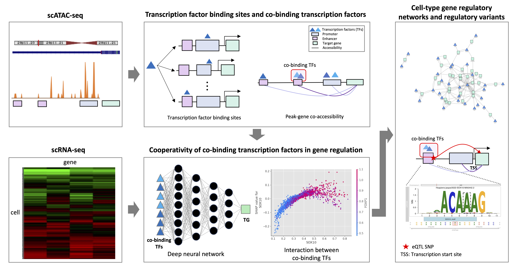

# coTF-reg

coTF-reg integrates single-cell RNA sequencing (scRNA-seq) and single-cell chromatin accessibility (scATAC-seq) to identify candidate pairs of transcription factors (TFs) that cooperate in human oligodendrocyte gene regulation. The workflow identifies candidate co-binding pairs, predicts target-gene expression with deep learning, and uses Shapley interaction scores to estimate pairwise effects on model predictions.

[Read the paper](https://doi.org/10.1038/s42003-025-07570-6) · [Browse the analysis scripts](code/Pipeline/) · [Browse the included data](data/)



## Explore the published results

Start with the [interaction summary](data/interaction_summary_median_1_CoV_0.5.csv). Each row summarizes a TF pair, including its mean Shapley interaction score, number of target genes, and percentile.

| Included files | Contents |
| --- | --- |
| [GRN_CoV.csv](data/GRN_CoV.csv) | Network records linking TF pairs, target genes, and regulatory peaks |
| [key_CoV.csv](data/key_CoV.csv) and [non_key_CoV.csv](data/non_key_CoV.csv) | Pair-level summaries for the key and non-key TF groups |
| [Primary TF expression](data/GE_median_1_DEG_TFs_df.csv) and [target-gene expression](data/GE_median_1_DEG_TGs_df.csv) | Expression matrices for the primary analysis |
| [ROSMAP TF expression](data/ROSMAP_oligo_mc_TF.csv) and [target-gene expression](data/ROSMAP_oligo_mc_TG.csv) | ROSMAP oligodendrocyte metacell expression matrices |
| [Supplementary workbook](data/adg3754_Tables_S1_to_S14.xlsx) and [motif profiles](data/JASPAR2022_modified.RData) | Inputs for peak–gene preparation and motif analysis |

To look up the SOX10–TCF12 pair highlighted in the paper, run this from the repository root with Python 3. The example reads the bundled summary and requires no additional packages.

```bash
python3 - <<'PY'
import csv
from pathlib import Path

summary = Path("data/interaction_summary_median_1_CoV_0.5.csv")
with summary.open(newline="", encoding="utf-8") as handle:
    for row in csv.DictReader(handle):
        if {row["TF1"], row["TF2"]} == {"SOX10", "TCF12"}:
            print("Mean interaction score:", row["Interaction_score_mean"])
            print("Target gene count:", row["num_TG"])
            print("Percentile:", row["percentile"])
PY
```

## Reproduce the analysis

The numbered scripts document the order of the study analyses. A full rerun requires adapting machine-specific input and output paths, obtaining source datasets and intermediate files referenced by the scripts, and configuring R and Python environments. Consult the paper for dataset provenance and methods.

| Step | Script | Purpose |
| --- | --- | --- |
| 0 | [Peak–gene preparation](code/Pipeline/Step0_paek_gene_data.R) | Assemble peak–gene links and oligodendrocyte peak groups. |
| 1 | [Binding-site inference](code/Pipeline/Step1_TFBS_infer.R) | Infer candidate TF binding sites using motif profiles. |
| 2 | [Co-enrichment](code/Pipeline/Step2_co-enrichment.R) | Evaluate TF motif co-enrichment in regulatory regions. |
| 3 | [Deep learning and Shapley analysis](code/Pipeline/Step3_Deep_Shapley.py) | Fit a target-gene expression model and compute interaction scores. The script is configured for MBP and refers to expression inputs under study-specific filenames. |
| 4 | [Network export](code/Pipeline/Step4_GRN_Cytoscape_fomatting.R) | Prepare gene regulatory network tables for Cytoscape. |
| 5 | [TF hierarchy](code/Pipeline/Step5_TF_hierarchy.R) | Classify regulatory TFs by their network connectivity. |
| 6 | [ROSMAP prediction](code/Pipeline/Step6_ROSMAP_prediction.py), [SEA-AD prediction](code/Pipeline/Step6_SEA_AD_prediction.py), and [eQTL mapping](code/Pipeline/Step6_eQTL_mapping.R) | Run follow-up prediction and eQTL analyses. |

The [additional analysis scripts](code/Other%20analysis/) cover metacell preparation and an oligodendrocyte UMAP. The modeling scripts use PyTorch, pandas, NumPy, scikit-learn, matplotlib, and tqdm. The R scripts use CRAN and Bioconductor packages, including dplyr, readxl, GenomicRanges, and motifmatchr.

## Citation

Choi, J. J., Svaren, J., & Wang, D. (2025). CoTF-reg reveals cooperative transcription factors in oligodendrocyte gene regulation using single-cell multi-omics. *Communications Biology*. [doi:10.1038/s42003-025-07570-6](https://doi.org/10.1038/s42003-025-07570-6)
